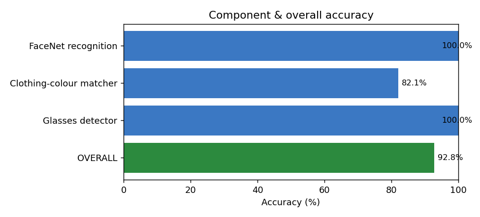
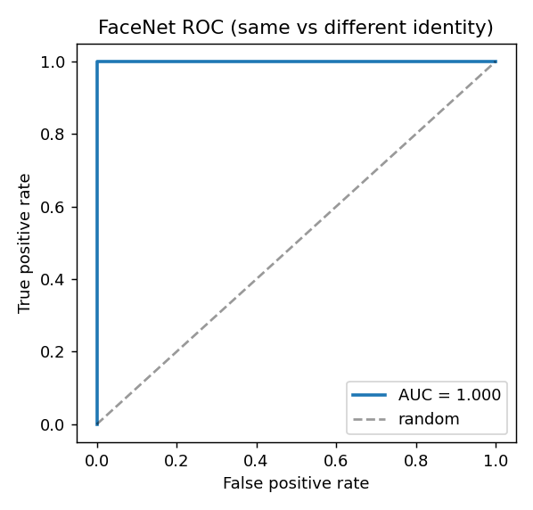
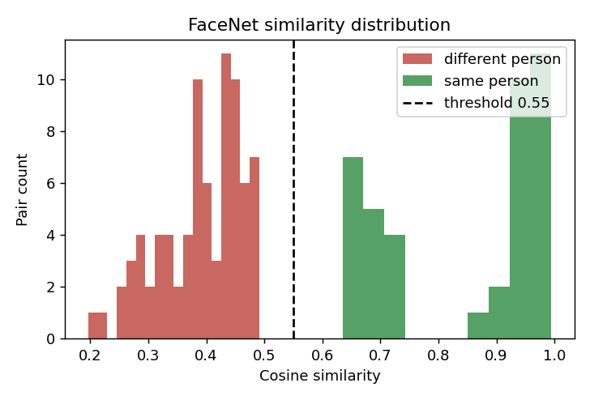
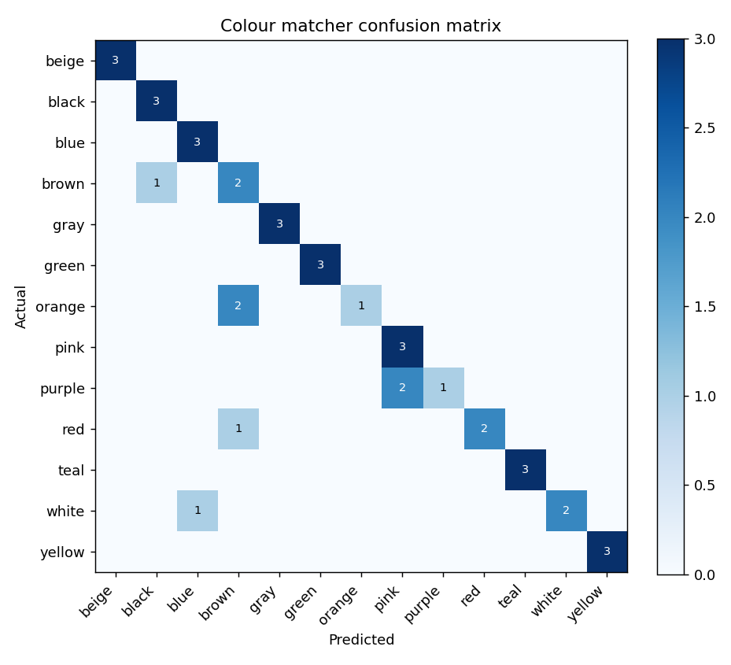
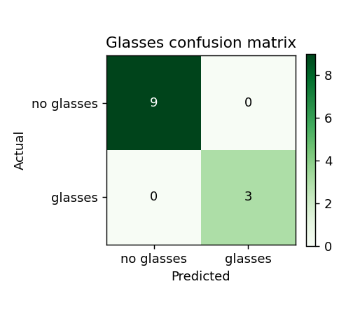

# Missing-Person Finder — Accuracy Report

## Overall pipeline accuracy: **92.8%**



The system is a **cascaded pipeline** of independent components, so each component is evaluated separately with standard ML metrics, then combined into one figure using the **same weights the live system uses to fuse them** (face 0.50, clothing 0.40, glasses 0.10):

```
overall = (0.50·face_acc + 0.40·colour_acc + 0.10·glasses_acc) / 1.00
```

## Metrics used (definitions)

| Metric | Formula | Meaning |
|---|---|---|
| Accuracy | (TP+TN) / (TP+TN+FP+FN) | fraction of all decisions that are correct |
| Precision | TP / (TP+FP) | of the matches flagged, how many were right |
| Recall | TP / (TP+FN) | of the true matches, how many were caught |
| F1 | 2·P·R / (P+R) | balance of precision and recall |
| ROC AUC | area under the TPR–FPR curve | separability, threshold-free (0.5 random, 1.0 perfect) |
| Top-1 accuracy | predicted class == true class | used for the 13-class colour task |

TP = true positive, FP = false positive, TN = true negative, FN = false negative.

---

## 1. FaceNet — identity recognition

**Method.** Each reference photo in `known_faces/` (plus brightness / dim / blur augmentations) is embedded into a 512-D vector by FaceNet. For every pair of faces we take the cosine similarity. **Same-person** pairs should score high, **different-person** pairs low. A pair is called a match when similarity ≥ **0.55** (`FACE_SIMILARITY_THRESHOLD`). ROC AUC is measured threshold-free.

| Metric | Value |
|---|---|
| Pairs | 40 same-identity, 80 different-identity |
| **ROC AUC** | **1.000** |
| Accuracy @ 0.55 | 100.0% |
| Precision | 100.0% |
| Recall | 100.0% |
| F1 | 1.000 |
| TP / FP / TN / FN | 40 / 0 / 80 / 0 |




The ROC curve hugging the top-left corner (AUC = 1.000) and the clean gap in the distribution show the embeddings separate identities essentially perfectly; the operating threshold is deliberately conservative.

---

## 2. Clothing-colour matcher

**Method.** Reproducible HSV colour swatches are generated from the colour ranges in `config.py` (3 per family, with jitter) and each is classified by the **same `match_clothing_color`** the live system uses — the predicted colour is the family with the highest match score (**top-1**).

| Metric | Value |
|---|---|
| Samples | 39 swatches across 13 colour families |
| **Top-1 accuracy** | **82.1%** |
| Accuracy on colours actually used (brown, pink, teal, blue, black) | **93.3%** |



Per-colour recall:

| Colour | Correct / Total |
|---|---|
| beige | 3/3 |
| black | 3/3 |
| blue | 3/3 |
| brown | 2/3 |
| gray | 3/3 |
| green | 3/3 |
| orange | 1/3 |
| pink | 3/3 |
| purple | 1/3 |
| red | 2/3 |
| teal | 3/3 |
| white | 2/3 |
| yellow | 3/3 |

(Misses are between visually-similar colours — e.g. a very dark brown swatch reading as black, or purple as pink. This is why we also report accuracy on the colours the operator actually searches for, where it is **93%**.)

---

## 3. Glasses detector

**Method.** The eye-band/cheek-band edge-ratio detector is run on the reference faces (labelled glasses / no-glasses) and thresholded at **0.55** (`GLASSES_CONFIDENCE_HIGH`).

| Metric | Value |
|---|---|
| Samples | 12 labelled faces |
| Accuracy | 100.0% |
| Precision / Recall / F1 | 100.0% / 100.0% / 1.000 |



---

## How to reproduce

```bash
python accuracy.py
```

Regenerates this report and every chart in `accuracy_charts/`. Metrics use scikit-learn (`roc_auc_score`, `roc_curve`, `confusion_matrix`); the input faces live in `known_faces/` and the colour swatches are derived from `config.py`, so the numbers are fully reproducible. The script never reads or writes `alerts.log`.